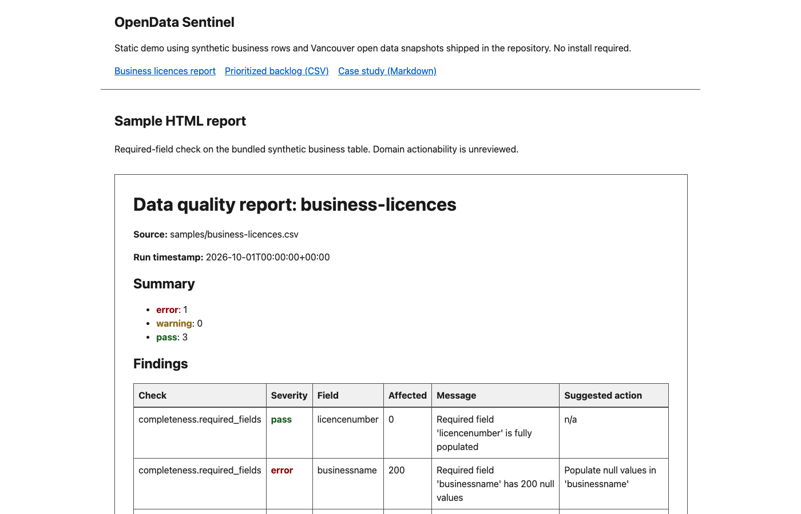
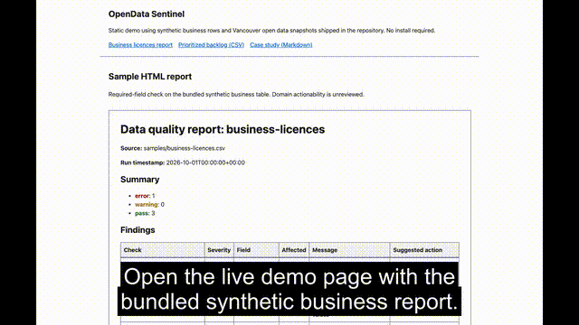
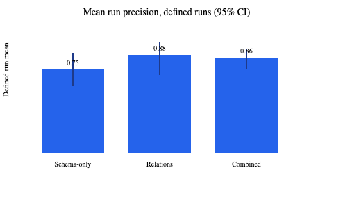
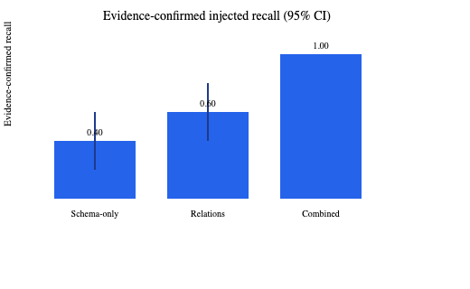
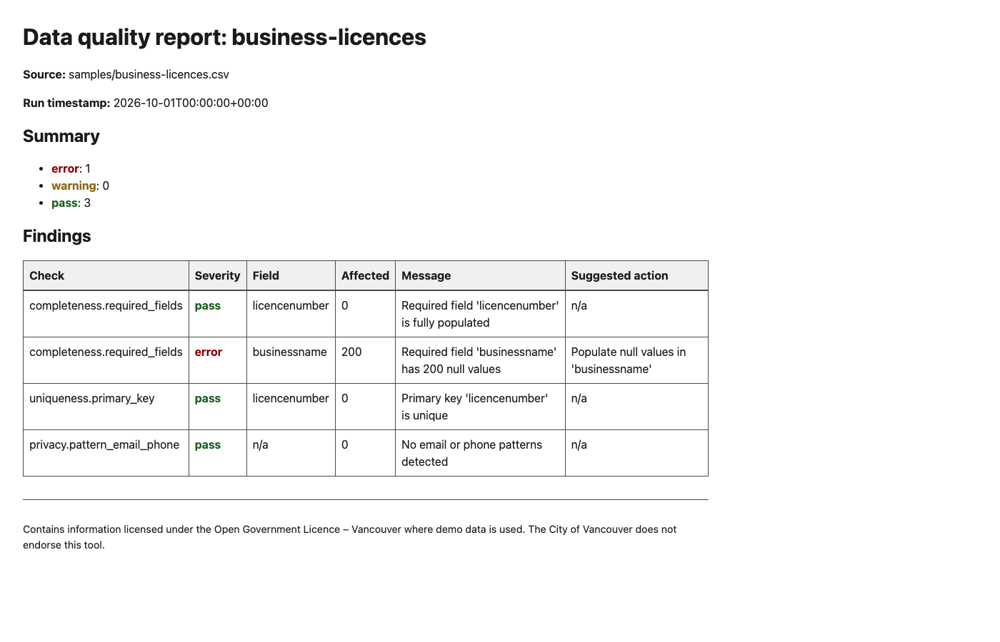
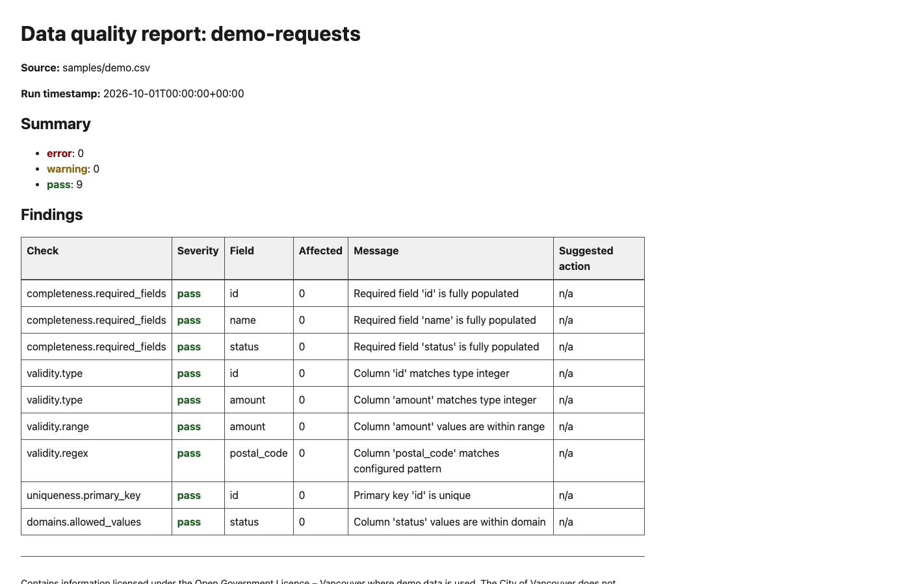
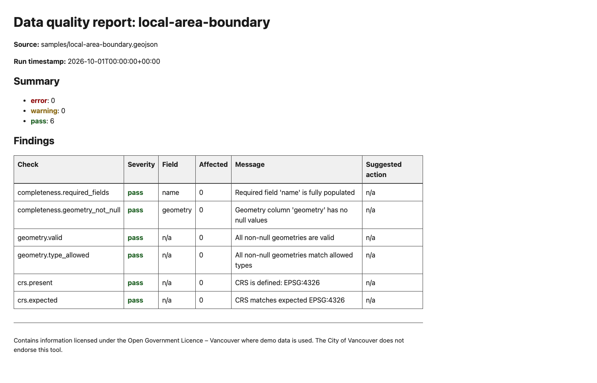
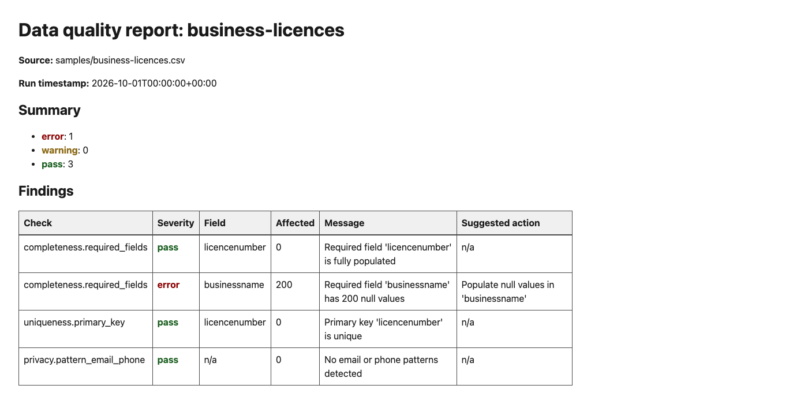
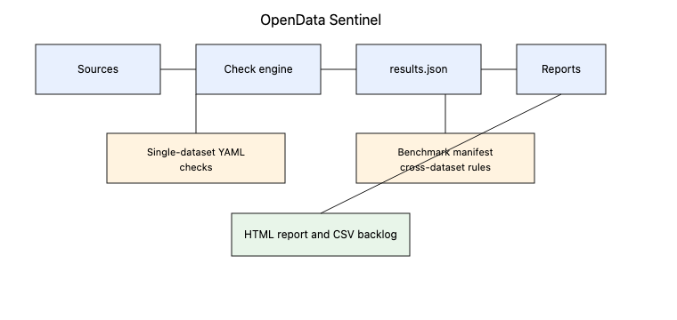

<p align="center" class="brand-mark">
  <picture>
    <source media="(prefers-color-scheme: dark)" srcset=".github/brand/parallex-mark-dark.png">
    
  </picture>
</p>

# OpenData Sentinel

OpenData Sentinel, by ParalleX Labs Inc., is an open-source data quality demonstration. It checks single files and links between related datasets, and writes a report and ranked fix list, unreviewed for real use. Its tests use five Vancouver snapshots and synthetic rows. For Canadian municipal open data teams that publish datasets and want problems found before users find them.



How it was made: its code and documentation were written with AI coding assistants under the direction of Amir Daneshpajouh, and checked by their tests and an AI-assisted release check before publication.

**[Try it live](https://parallexlabs.github.io/opendata-sentinel/)** (static demo; no install)

[](https://parallexlabs.github.io/opendata-sentinel/media/demo.mp4)

Benchmark precision on frozen snapshots (mean run precision, 95% CI):





| Example | Preview |
|---|---|
| Synthetic business licences report |  |
| Demo CSV report |  |
| Local area GeoJSON report |  |
| Findings detail |  |
| Component flow |  |

### How it works


1. Load a dataset: CSV, GeoJSON, Shapefile, GeoPackage, or a portal link (OpenDataSoft, ArcGIS or CKAN).
2. Inspect it: schema, row count and coordinate system.
3. One dataset: run the checks set in a YAML configuration file.
4. Or, for related datasets: run the cross-dataset and drift checks from the benchmark manifest on frozen snapshots.
5. From a results file, score findings with rule-based weights (not calibrated probabilities).
6. Generate a static HTML report.
7. Export a prioritized fix list as a CSV backlog (its practical usefulness is unreviewed).

### Architecture


- **Sources and loaders** read local files or public portal APIs under the [network policy](docs/network-policy.md).
- **Check engine** runs YAML-configured single-table checks or manifest-driven benchmark relations.
- **Reporters** write `results.json`, HTML reports and CSV backlogs from the same results file.

### Design choices

- **Frozen Vancouver snapshots plus synthetic business rows** keep the cross-dataset benchmark reproducible without publishing real business records.
- **Rule-based finding scores** rank issues for review; they are not calibrated probabilities.
- **Separate single-dataset and benchmark paths** share one results format so reports and backlogs use the same commands.
- **Read-only connectors** inspect portals but never write back to publishers.

### Why it matters

Its benchmark also checks whether related open datasets agree with each other, not only each file alone.

### Showcase media

Regenerate hero images, charts, captions and the demo video with:

```bash
python3 scripts/make_showcase_media.py
```

Large video files are written to `showcase-media/` (not committed). Copy `showcase-media/demo.mp4` into `docs/media/` before enabling GitHub Pages if you want the README video link to resolve on the site.

---

OpenData Sentinel (`opendata-sentinel`) is an open-source data quality assurance tool by **ParalleX Labs Inc.** It is designed to help Canadian municipalities check open datasets before and after publication, and includes a **versioned cross-dataset consistency benchmark** on five Vancouver snapshots plus generated business fixtures.

This is an engineering demonstration using attributed non-business open data and synthetic business rows. Real business records are withheld. Domain actionability is unreviewed. No clients or production deployments are claimed.

Inspect the [required-field workflow and report preview](docs/case-study.md), [current release verification](docs/release-verification.md) and [sample provenance](docs/sample-provenance.md).

## Open by design

**We build in the open.** ParalleX Labs Inc. publishes its tools, methods and learning materials under open licences, so public-interest teams can use them, check how they work and adapt them freely. Open work is easier to trust, because anyone can see exactly how a result is produced. Code is licensed under Apache-2.0.

**Company code, third-party data.** Software, documentation and synthetic examples in this repository are created by ParalleX Labs Inc. Vancouver open datasets and derivatives are published under the [Open Government Licence - Vancouver](https://opendata.vancouver.ca/pages/licence/) with attribution (see `docs/DATA_LICENCES.md`). This repository contains no client data or confidential third-party material.

## Demonstrated package

| Capability | Generic tools (see sources) | Portal metadata tools (e.g. Neumaier et al.) | This Vancouver benchmark package |
|---|---|---|---|
| Single-table schema validation | Yes (Frictionless, Pandera, GE, dbt, Soda) | Partial (metadata) | Yes (internal + Frictionless baseline on frozen snapshots) |
| Cross-dataset relation checks | Yes (Frictionless foreign keys; arbitrary Pandera checks; GE multi-source comparison; dbt relationships; Soda reconciliation) | No (record-level) | Yes (manifest-defined municipal rules on frozen snapshots) |
| Cross-year snapshot drift (2023 vs 2024 capital budget) | Possible with custom rules | No | Yes (packaged rule + evaluation) |
| Same-dataset schema drift (snapshot b copy) | Possible with custom rules | No | Yes (injected benchmark only) |
| Heuristic finding scores | Varies by tool | No | Yes (rule-based weights; not calibrated probabilities) |
| Held-out evaluation workflow | Varies by tool | No | Yes (provisional labels pending human review) |
| Live municipal portal integration | Varies by connector | Catalogue crawl | Yes (Vancouver API; opt-in tests) |

Sources: [Frictionless](https://framework.frictionlessdata.io/) ([foreign keys](https://specs.frictionlessdata.io/table-schema/#foreign-keys)), [Pandera checks](https://pandera.readthedocs.io/en/stable/checks.html), [Great Expectations multi-source comparison](https://greatexpectations.io/expectations/expect_query_results_to_match_comparison/), [dbt tests](https://docs.getdbt.com/docs/build/data-tests), [Soda reconciliation](https://docs.soda.io/reference/contract-language-reference/reconciliation-checks), [Neumaier et al., ACM JDIQ 10.1145/2964909](https://doi.org/10.1145/2964909), [Kubler et al., DGO 10.1145/2912160.2912167](https://doi.org/10.1145/2912160.2912167), [Ding et al., GeoInformatica 10.1007/s10707-019-00384-9](https://doi.org/10.1007/s10707-019-00384-9).

## Quick start

```bash
python -m venv .venv
source .venv/bin/activate
python -m pip install -c requirements-tested.txt ".[dev,benchmark]"

# Single-dataset QA
civic-data-qa inspect samples/demo.csv
civic-data-qa check samples/demo.csv --config examples/demo.csv.yml

# Cross-dataset benchmark (hashed snapshots default to data/snapshots)
civic-data-qa benchmark run
```

See [`RESULTS.md`](RESULTS.md) for current generated metrics. The business table is now a 200-row source-free fixture, so earlier real-business measurements do not apply. All current results are local observations, externally unverified, conditional on five handcrafted injection families, one seed and the mixed frozen inputs. They do not establish municipal accuracy.

The contribution is a reproducible configuration, snapshot and evaluation package with no first-of-kind or new-method claim. Human/domain actionability is unverified. The comparator is a sampled internal-plus-Frictionless schema ablation using an ordered prefix of up to 5,000 rows; relations inspect all 200 synthetic business rows. Other cited tools are not benchmarked. Facility-name uniqueness is an artificial assumption; duplicate facilities are not demonstrated City errors (see the [voting source](https://opendata.vancouver.ca/explore/dataset/voting-places-2017/)).

## Benchmark

The manifest evaluates three relation check types using five non-business Vancouver snapshots and one generated business fixture under Apache-2.0. Business references and dates exercise configured fixture rules; no municipal business quality is measured. Default paths are `benchmark/manifest.yml`, `benchmark/adjudications/held_out.jsonl`, `benchmark/results` and `data/snapshots`. See [benchmark scope](docs/benchmark.md), [technical report](docs/technical-report.md) and [release data decision](docs/DATA_LICENCES.md).

Run `bash scripts/regenerate_all.sh` to regenerate business fixtures, benchmark artifacts, result pages, figures and all portable examples. The development extra includes the wheel build backend; after the documented constrained installation, `python scripts/wheel_smoke.py` requires no separate backend installation.

## Supported inputs

| Type | Example |
|---|---|
| CSV | `samples/demo.csv` |
| GeoJSON | `samples/local-area-boundary.geojson` |
| Shapefile | `tests/fixtures/points.shp` |
| GeoPackage | `tests/fixtures/multi.gpkg` (use `--layer`) |
| OpenDataSoft Explore v2.1 | `https://opendata.vancouver.ca/explore/dataset/local-area-boundary/` |
| ArcGIS FeatureServer | Public layer URL |
| CKAN | `https://catalogue.example/dataset/package-id` |

The portal connector implements [OpenDataSoft Explore v2.1](https://help.opendatasoft.com/apis/ods-explore-v2/); Socrata support is not claimed. See [network policy](docs/network-policy.md) for redirect/retry limits and the DNS validation boundary.

## CLI reference

| Command | Description |
|---|---|
| `inspect <source>` | Print schema, row count, CRS |
| `check <source> --config <yml>` | Run configured checks |
| `benchmark info` | Show benchmark manifest summary |
| `benchmark run` | Run cross-dataset consistency benchmark |
| `report <results.json> -o report.html` | Generate static HTML report |
| `backlog <results.json> -o backlog.csv` | Export prioritized remediation list |

## Demo data licence

Vancouver samples are under the [Open Government Licence – Vancouver](https://opendata.vancouver.ca/pages/licence/). See [sample provenance](docs/sample-provenance.md) for attribution text.

## Limitations

- Read-only: no write-back to portals
- Benchmark adjudication set is small; intervals are wide
- Privacy checks are heuristic screening only
- Single municipality evaluated; generalization unverified

## Development

```bash
mkdir -p state
ruff check src tests scripts
mypy src
pyright src
pytest --cov=civic_data_qa --cov-fail-under=90 -m "not network" --basetemp=state/test-tmp
mkdocs build --strict
```
